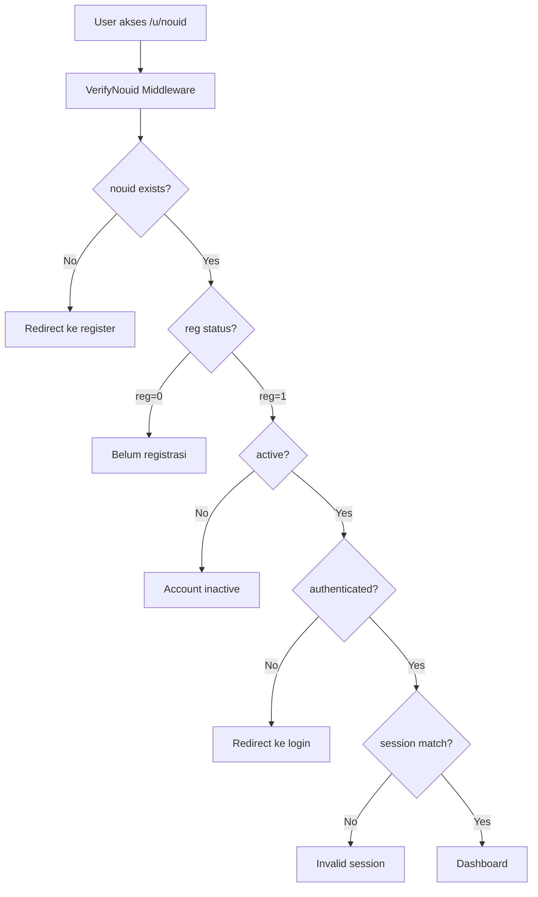

# Sistem Autentikasi Aplikasi Siswa

## Overview

Aplikasi ini menggunakan sistem autentikasi berbasis **PIN 6 digit** dengan **OTP** untuk verifikasi nomor telepon. Sistem ini dirancang khusus untuk siswa dengan menggunakan `nouid` (Nomor UID) sebagai identifier utama.

## Arsitektur Autentikasi

### 1. Model dan Database

#### Model Utama:
- **`Indentitas`** (`mai2.tindentitas`) - Master data identitas siswa
- **`Siswa`** (`mai2.tsiswa`) - Data siswa yang extend dari `Authenticatable`
- **`Tregistrasi`** (`mai4.tregistrasi`) - Data registrasi wali siswa
- **`Totps`** - Tabel OTP untuk verifikasi

#### Relasi:
```php
Indentitas (1) -> (1) Siswa
Indentitas (1) -> (1) Tregistrasi
Siswa (1) -> (1) Tsiswa1 (data tambahan)
```

### 2. Authentication Guard

```php
// config/auth.php
'guards' => [
    'siswa' => [
        'driver' => 'session',
        'provider' => 'siswas',
    ],
],
```

**Default Guard**: `siswa` (bukan `web`)

### 3. Middleware System

#### `VerifyNouid` Middleware
Middleware utama yang menangani verifikasi user:

```php
// bootstrap/app.php
'verify.nouid' => \App\Http\Middleware\VerifyNouid::class,
```

**Fungsi:**
1. **Verifikasi nouid exists** - Cek apakah nouid valid di database
2. **Cek status registrasi** - `reg === 0` (belum registrasi) vs `reg === 1` (sudah registrasi)
3. **Cek status aktif** - `active === true/false`
4. **Cek autentikasi** - `Auth::guard('siswa')->check()`
5. **Cek session consistency** - `session('current_nouid') === $nouid`

## Flow Autentikasi

### 1. Akses Dashboard (`/u/{nouid}`)



### 2. Status Dashboard

Dashboard menampilkan konten berbeda berdasarkan status:

#### Belum Registrasi (`reg === 0`):
- Tampilkan informasi siswa
- Tombol "Daftar Sekarang"
- Status registrasi

#### Sudah Registrasi (`reg === 1`):
- **Belum ada PIN** (`pin === false`):
  - Tombol "Buat PIN"
  - Modal SetupPin (3 tahap: Phone → OTP → PIN)
- **Sudah ada PIN** (`pin === true`):
  - **Belum login**: Tombol "Login" → Modal PIN
  - **Sudah login**: Dashboard lengkap

### 3. Proses Registrasi

#### Tahap 1: Data Wali
```php
// routes/auth.php
Route::resource('register', RegisteredUserController::class)
```

**Validasi:**
- Nama, NIK, KK, alamat
- Upload KTP/Paspor
- Nomor telepon

#### Tahap 2: Setup PIN
```php
// routes/auth.php
Route::post('/setup-pin', [RegisteredUserController::class, 'setupPin'])
```

**Proses:**
1. **Phone**: Input/verifikasi nomor HP
2. **OTP**: Kirim dan verifikasi OTP
3. **PIN**: Buat PIN 6 digit + konfirmasi

**Database Update:**
```php
// Update PIN dan tel di tsiswa
$indentitas->siswa->update([
    'pin' => Hash::make($validated['pin']),
    'tel' => formatPhoneNumber($phone),
]);

// Update status registrasi
Indentitas::where('nouid', $nouid)->update(['sta' => 0]);
```

### 4. Proses Login

#### Login dengan PIN
```php
// routes/auth.php
Route::post('/verify-pin', [AuthenticatedSessionController::class, 'store'])
```

**Validasi:**
```php
// app/Http/Requests/Auth/LoginRequest.php
'nouid' => 'required|string|exists:mai2.tindentitas,nouid',
'pin' => 'required|digits:6|numeric',
```

**Rate Limiting:**
- **Max attempts**: 3 kali
- **Throttle**: 1 menit setelah max attempts
- **OTP auto-send**: Jika gagal 3 kali, kirim OTP otomatis

**Proses:**
1. Cek rate limiting
2. Verifikasi PIN dengan `Hash::check($pin, $siswa->pin)`
3. Login dengan `Auth::guard('siswa')->login($siswa)`
4. Set session `current_nouid`
5. Regenerate session

### 5. OTP System

#### Kirim OTP
```php
// routes/auth.php
Route::post('/otp/send', [OtpController::class, 'sendOtp'])
```

**Proses:**
1. Generate OTP 6 digit
2. Simpan ke `Totps` dengan expiry 5 menit
3. Kirim via WhatsApp API
4. Rate limiting: max 5 attempts per phone

#### Verifikasi OTP
```php
// routes/auth.php
Route::post('/otp/verify', [OtpController::class, 'verifyOtp'])
```

**Validasi:**
- OTP exists dan belum expired
- OTP match
- Rate limiting untuk percobaan

### 6. PIN Recovery

#### Lupa PIN
```php
// routes/auth.php
Route::post('/lupa-pin', [OtpController::class, 'forgotRequestOtp'])
```

**Proses:**
1. Kirim OTP ke nomor terdaftar
2. Verifikasi OTP
3. Reset PIN dengan proses yang sama seperti setup PIN

## Security Features

### 1. Rate Limiting
- **Login attempts**: 3 kali, throttle 1 menit
- **OTP send**: 5 kali per phone
- **OTP verify**: 5 kali per phone

### 2. Session Management
- **Session regeneration** setelah login
- **Session consistency** check dengan nouid
- **Auto logout** jika session tidak valid

### 3. PIN Security
- **6 digit numeric** only
- **Hashed storage** dengan Laravel Hash
- **Confirmation required** saat setup

### 4. OTP Security
- **6 digit random** number
- **5 minutes expiry**
- **One-time use** (deleted after verification)
- **Phone number validation**

## Route Structure

### Authentication Routes (`routes/auth.php`)
```php
// Guest routes
Route::get('/login', [SiswaController::class, 'index'])->name('login');
Route::post('/verify-pin', [AuthenticatedSessionController::class, 'store'])->name('siswa.verify-pin');

// Registration
Route::resource('register', RegisteredUserController::class)->only(['index', 'create', 'store']);
Route::post('/auth/register', [RegisteredUserController::class, 'store'])->name('auth.register');

// PIN Management
Route::get('/setup-pin', [SiswaController::class, 'showSetupPinForm'])->name('siswa.show-setup-pin');
Route::post('/setup-pin', [RegisteredUserController::class, 'setupPin'])->name('siswa.process-setup-pin');
Route::get('/lupa-pin', [PasswordResetLinkController::class, 'create'])->name('siswa.show-lupa-pin');
Route::post('/lupa-pin', [OtpController::class, 'forgotRequestOtp'])->name('siswa.forgot-pin');

// OTP
Route::post('/otp/send', [OtpController::class, 'sendOtp'])->name('otp.send');
Route::post('/otp/verify', [OtpController::class, 'verifyOtp'])->name('otp.verif');

// Authenticated routes
Route::post('/logout', [AuthenticatedSessionController::class, 'destroy'])->name('siswa.logout');
```

## Frontend Integration

### 1. Dashboard Logic
```typescript
// Dashboard/Index.tsx
const { auth, summary } = usePage().props;

// Status checking
if (summary.reg === 0) {
    // Belum registrasi
} else if (!summary.pin) {
    // Belum ada PIN
} else if (!auth.user) {
    // Belum login
} else {
    // Dashboard lengkap
}
```

### 2. PIN Verification
```typescript
// Pin.tsx
const handleSubmit = (pin: string) => {
    router.post(route('siswa.verify-pin', { nouid }), {
        pin,
        onSuccess: () => {
            // Login berhasil
        }
    });
};
```

### 3. Setup PIN Flow
```typescript
// SetupPin.tsx - 3 tahap
const [step, setStep] = useState<'phone' | 'otp' | 'pin'>('phone');

// Tahap 1: Phone
// Tahap 2: OTP verification  
// Tahap 3: PIN creation
```

## Error Handling

### 1. Validation Errors
- **PIN salah**: "PIN yang Anda Masukkan Salah. Sisa percobaan: X"
- **Rate limited**: "Terlalu banyak percobaan login"
- **OTP expired**: "OTP telah kadaluarsa"
- **Invalid nouid**: "Data siswa tidak ditemukan"

### 2. System Errors
- **Database error**: Log error dan tampilkan pesan umum
- **OTP service error**: Fallback dan retry mechanism
- **Session error**: Auto redirect ke login

## Best Practices

### 1. Security
- ✅ PIN hashing dengan Laravel Hash
- ✅ Rate limiting untuk semua endpoint
- ✅ Session regeneration
- ✅ Input validation dan sanitization
- ✅ Error logging tanpa expose sensitive data

### 2. User Experience
- ✅ Clear error messages
- ✅ Progress indicators untuk multi-step process
- ✅ Auto-redirect setelah success
- ✅ Consistent UI/UX patterns

### 3. Code Organization
- ✅ Separation of concerns (Controller, Request, Middleware)
- ✅ Consistent naming conventions
- ✅ Proper error handling
- ✅ Comprehensive logging

## Troubleshooting

### Common Issues:

1. **"Data siswa tidak ditemukan"**
   - Cek nouid di database `mai2.tindentitas`
   - Pastikan relasi dengan `tsiswa` benar

2. **"PIN yang Anda Masukkan Salah"**
   - Cek hashing di database
   - Pastikan input 6 digit numeric

3. **"OTP tidak ditemukan"**
   - Cek tabel `totps`
   - Pastikan belum expired (5 menit)

4. **"Sesi tidak valid"**
   - Cek session `current_nouid`
   - Pastikan match dengan route parameter

5. **Rate limiting issues**
   - Cek cache untuk rate limiter
   - Clear cache jika diperlukan

